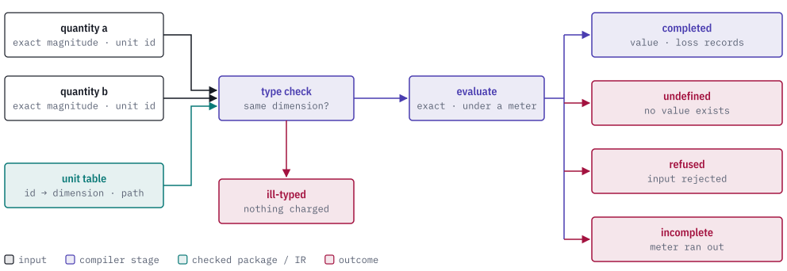

# quire-semantic-value

quire-semantic-value is a `no_std` Rust library of runtime values for the
Quire stack: quantities with units, enumeration members, records, tuples and
unions checked against their declared shape, object references, and the
records of what an operation dropped and where. It builds on the exact-value
kernel in [quire-exact](https://github.com/agent-ix/quire-exact) and uses only
`core` and `alloc`.

The QSL evaluator, the compiler and the code-generating backends share these
values, including the result of an operation that produces no value.

<picture>
  <source media="(prefers-color-scheme: dark)" srcset="docs/images/hero-dark.svg">
  
</picture>

> **Status: public prerelease.** The API is still changing and the crate is not
> published (`publish = false`). Expect breaking changes.

## Values

| A raw number lacks | This crate adds | Module |
| --- | --- | --- |
| a unit | an exact magnitude plus a unit id, resolved through a unit table to a dimension and an exact conversion path to a canonical root; mismatched dimensions are refused before anything is charged | `quantity`, `unit` |
| a stated way to end | every computation stops as completed, undefined, refused or incomplete (the kernel's outcome) | `stop` |
| a record of what was dropped | a loss record for each rounding or IEEE conversion step, tied to the expression that produced it | `loss`, `location` |
| a place | an origin (which declaration) and a child-index path inside it | `location` |
| a declared shape | records, tuples, unions and model object types checked against a registry, with checked equality | `declaration`, `enumeration` |
| structure | finite values built from a containment graph; shared nodes become one immutable value and a cycle is refused | `containment` |
| identity for objects | references that are terminal names, resolved only through an object closure; no reference can dangle | `object_closure` |

The crate does not mint a node, effective or population identity. It checks the
ones it is handed.

## Usage

The smallest runnable use is in `tests/union_registry.rs`. It declares a
`Shape` union with members `Rect(Integer, Integer)`, `Circle(Integer)` and
`Empty`, builds a registry, and constructs values that the registry checks:

```rust
let env = TypeEnvironment::new([shape()], []).unwrap();
let (position, rect) = env.union_member_named(key(1), "Rect").unwrap();
assert_eq!(position, 0);
assert_eq!(rect.positions(), &[ValueType::Integer, ValueType::Integer]);
assert_eq!(rect.member().unwrap().variant(), variant(12));
assert_eq!(env.union_member(key(1), variant(10)).unwrap().0, 1);
assert!(env.union_member_named(key(1), "rect").is_none());
let empty = env.union(key(1), variant(10), vec![]).unwrap();
assert_eq!(empty.occ(), Integer::one());
let value = env
    .union(key(1), variant(12), vec![integer(2), integer(3)])
    .unwrap();
assert!(env.admits(&ValueType::Composite(key(1)), &value).unwrap());
```

`shape()`, `key` and `variant` are small helpers defined in that file. A
payload with the wrong number or type of positions is refused.

## Modules

| Module | Holds |
| --- | --- |
| `quantity`, `unit` | quantities, units, dimensions, compound units, add, subtract, multiply, divide, power, comparison and explicit conversion |
| `declaration`, `enumeration` | the type registry, record, tuple, union and enum values, and checked equality |
| `containment`, `object_closure` | value graphs and object references |
| `relationship_extent`, `supplied_membership` | model-supplied navigation extents and the accounting for membership checks |
| `fairness`, `model_transition` | checked property and fairness values, and the applied operation a transition system steps by, in canonical RFC 8785 form |
| `stop`, `loss`, `location` | how a computation ends, what it dropped, and where |
| `call`, `checking`, `definition`, `semantic_node` | refusal vocabularies and admission limits that callers and backends share |

## Quire ecosystem

<picture>
  <source media="(prefers-color-scheme: dark)" srcset="docs/images/ecosystem-dark.svg">
  
</picture>

This crate depends on
[quire-exact](https://github.com/agent-ix/quire-exact) for the exact values and
meter, and on [quire-canonical](https://github.com/agent-ix/quire-canonical)
for the one RFC 8785 encoder (without `std`). It is used by
[quire-spec-language](https://github.com/agent-ix/quire-spec-language), whose
evaluator and checker share these values.

## Building and testing

```bash
make test           # cargo test
make build-no-std   # build for thumbv7em-none-eabi, proving no std is pulled in
make ci             # fmt-check, lint, test, no_std build, cargo deny, docs
```

The `no_std` build needs `rustup target add thumbv7em-none-eabi`. The crate
forbids `unsafe` code.

## Specification

`spec/` holds the requirements this crate owns directly: the admission and
dangling-reference rules of the object closure, and the rule that the crate
mints no node, effective or population identity. The requirements for the other
modules are owned by quire-spec-language and quire-specification (private), and
moving them here is remaining work.

## Contributing

Every contribution needs a signed Contributor License Agreement; see
[CONTRIBUTING.md](CONTRIBUTING.md) and [CLA.md](CLA.md).

## License

AGPL-3.0-or-later. See [LICENSE](LICENSE).
